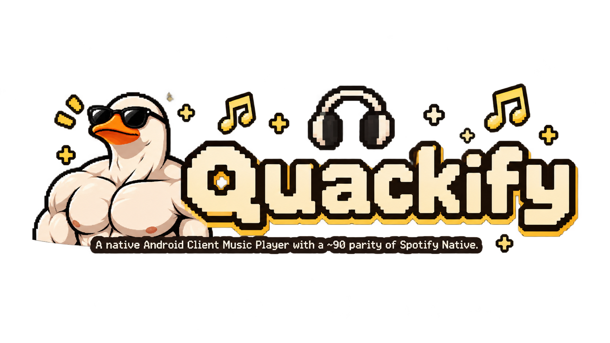

<div align="center">
  <h1>Quackify</h1>
  
  <p>Quackify is the continuation of SpotiDuck, a native Android music client built with Jetpack Compose and Material 3. It offers a familiar streaming experience, inspired by modern player apps, without needing a WebView.</p>
</div>

## Features

- Browse the home screen with filter chips
- Search for songs, artists, playlists, and podcasts
- View your library's playlists and albums
- Play playlist and album tracks with the mini player
- Expand to the full Now Playing screen with seek controls and lyrics
- Podcasts with chapters, playback speed, and episode video

## Getting Started

### 1. Clone the repository

```bash
git clone https://github.com/23fpsz/Quackify.git
cd Quackify
```

### 2. Build & run

```bash
./gradlew assembleDebug
```

Or open Android Studio, select the **app** configuration, and hit **Run** (`Shift + F10`).

## Contributing

1. Fork the repo
2. Create your feature branch (`git checkout -b feature/awesome-feature`)
3. Commit your changes (`git commit -m 'feat: add awesome feature'`)
4. Push to the branch (`git push origin feature/awesome-feature`)
5. Open a pull request

## About

Quackify is a community driven project built with passion by:

- **Main dev:** [23fpsz](https://github.com/23fpsz)
- **Lead dev backend:** [xzyyysh](https://github.com/xzyyysh)
- **Backend & UI dev:** [AldySan](https://github.com/AldySan)

## License

This project is licensed under the GNU General Public License v3.0 (GPL-3.0) - see the [LICENSE](LICENSE) file for details.

## Disclaimer

This project is not affiliated with, endorsed by, or sponsored by Spotify AB or any other streaming service. All product names, trademarks, and registered trademarks mentioned or referenced are the property of their respective owners. Quackify is an independent, community-driven client intended for educational and personal use. Users are responsible for complying with the terms of service of any service they connect to. No proprietary assets or credentials are distributed with this project.
